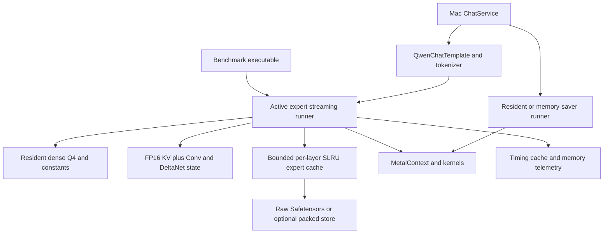
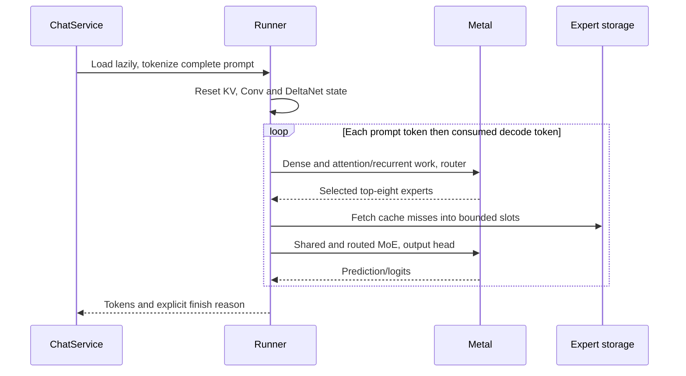

# QwenFieldfare architecture

Source audit: 2026-11-17, base commit `72fb923`. Implemented behavior below is
separate from the proposed server. [TODO](../TODO.md) owns task status;
[decisions](DECISIONS.md) own design constraints.

## Implemented modules

| Module | Responsibility and owning source |
| --- | --- |
| Core | Model IO, Swift orchestration, Metal execution, bounded expert storage and telemetry |
| Mac | SwiftUI app; `ChatService` owns runner/tokenizer references and visible/internal conversation |
| Presentation | Model-free Markdown parsing, version presentation and model-reveal policy |
| Bench | Retained-runner measurements, diagnostic profiling, checkpoint-hashed teacher forcing |
| Pack | Optional packed-expert builder; raw checkpoint remains the production default |

Core paths are relative to `Sources/QwenFieldfareCore/`:
`Runtime/Generation/QwenQ4ActiveExpertStreamingRunner.swift` is the production
active path; `QwenQ4ChatRunner.swift` provides resident and memory-saver modes
and the tokenizer wrapper. `QwenForwardRunner.swift` is CPU diagnostic/math
scaffolding with synthetic weights, not the production inference backend.
`Infrastructure/Metal/MetalContext.swift` owns device, queue, runtime shader
compilation and a locked pipeline cache. `Metal/Attention/attention.metal` and
`Metal/LinearAttention/deltanet.metal` contain attention, recurrent and MoE work.

## Model loading and validation

`QwenModelDirectory.validate` canonicalizes the root, requires metadata to be
regular files resolving directly inside it, and checks a nonempty shard map.
Index reads are descriptor-checked, nonblocking/no-follow at the resolved leaf,
capped at 16 MiB and return typed parse/read/size errors. Internal metadata links
are supported. It also rejects path components, escaping shard symlinks and
non-regular shards. It does not validate the full Qwen tensor contract.
`QwenResidentWeights` now uses the shared validated-descriptor path described
below for header metadata, selected BF16/F32 tensors and embedding rows. This CPU
utility is distinct from the Q4 Fast Resident mode. The active-streaming Q4 reader
also uses shared descriptor/header validation and owned whole-file mappings (S1-01c,
below). The fallback Q4ChatRunner resident/memory-saver reader now uses the same
validated descriptor/mapping infrastructure (S1-01d). The pack builder remains
on its independent Safetensors reader.
Preflight must be shared by every entry point, before large Metal allocations.
The checkpoint remains external; weights must never be copied into this repo.

## Shared Safetensors validation (S1-01a/b/c/d)

`Infrastructure/ModelIO/QwenSafetensorsHeader.swift` provides an internal shared
metadata parser and an owned-descriptor wrapper. **QwenResidentWeights and the
both Q4 runtime readers are migrated**. The pack builder remains on its
independent implementation. Inference kernels, numerical
precision, quantization, sampling and expert-cache allocation are unchanged.

The parser reuses `QwenTensorInfo` and the existing EINTR-aware
`QwenQ4ExpertStore.preadFully` primitive. Its metadata reads are the
8-byte prefix and header; the owner also supports checked selected-payload reads. Header length is decoded bytewise as little-endian,
must be positive, <=100,000,000 decimal bytes (the existing resident-reader cap),
and fit the opened file before allocation. Header helper offsets/counts are bounded
by 100,000,008; selected-payload calls are bounded by the validated file size <=
Int.max/off_t.max, avoiding unchecked general offset casts.
The shared parser/descriptor wrapper performs no complete-shard read, copy, mapping
or hash and creates no Metal buffer. The shared runtime mapping owner below
maps the same validated descriptor without copying shard contents.
The cap bounds header bytes, not Foundation JSON-object overhead/process footprint.

Metadata requires a UTF-8 object header (raw NUL/UTF-16/32 inputs rejected), string-valued __metadata__, complete tensor
fields, exact nonnegative integer dimensions/offsets (not bool/float/string),
checked shape multiplication and dtype-byte multiplication, ordered/in-file
ranges, exact byte extents and nonoverlapping nonempty tensor ranges. Scalars
have one element; zero dimensions yield zero elements even when other dimensions
would overflow a product. Payload bounds prove absolute offset additions fit Int.
Fixed-width BOOL/integer/FP16/BF16/FP32/FP64 metadata widths are recognized; other
encodings are typed errors. This does not add model/dtype execution support:
model-specific required names/shapes/quantization/consumed dtypes still need S1-02.

`QwenSafetensorsFile` opens a caller-resolved file URL with
O_RDONLY|O_NONBLOCK|O_NOFOLLOW|O_CLOEXEC, fstats the actual opened object and rejects
non-regular/short inputs before reading. It owns/closes its descriptor on failure
and deinit. Consumers must retain the owner, borrow (not close) its descriptor,
and use that descriptor for later reads instead of reopening a path with cached
offsets. Callers must resolve legitimate links **and enforce model-root containment
beforehand**; this wrapper does not establish root containment. An unresolved
leaf symlink is rejected; resolving an approved internal link is supported.

The opened descriptor pins device/inode identity across path replacement. Size,
mtime and ctime are compared before/after parse; `verifyUnchanged` can detect
later observed changes on that descriptor. This is not a write lock or content
hash: external writes/truncation after a check remain possible, and opening a
resolved path does not solve ancestor-directory replacement. Checkpoints must
remain immutable while owned; reader/mmap integration must define failure/retry
and lifecycle policy, never claim that validation alone prevents mmap SIGBUS.

This bounded utility is not a full canonical Safetensors framework: it permits
payload gaps/trailing bytes and does not independently detect duplicate JSON
keys or validate payload contents. Metadata parsing is no proof of checkpoint
integrity or numerical equivalence. These limits remain explicit after reader
integration. Original 131/132 release blocker is unchanged.

## Migrated CPU resident reader (S1-01b)

`QwenResidentWeights` replaces its header-only cache with one validated descriptor
owner per encountered shard. It resolves the model root, requires safe basename
shard names, resolves approved internal links and applies the existing direct-root
containment policy before opening the resolved leaf. The reader serializes cached
ownership, metadata lookup and reads with its existing lock. Header parsing occurs
once per cached owner, not again for every tensor. Public metadata keeps its old
header-size semantics (length excludes the eight-byte prefix); returned paths are
informational, not authorization to reopen an independently mutable pathname.

Tensor and row reads call `readPayload` on the same opened descriptor. Tensor
offsets remain relative to the data region; absolute position is **8 + header
length + relative offset**. Dynamic payload ranges are bounded and identity is
checked before/after reading. BF16/F32 decoding preserves float bit values using
unaligned little-endian loads. Full tensors still use the CPU API's selected raw
tensor bytes plus decoded Float array; rows use one row's raw bytes plus output.
No complete-model residency, mmap or zero-copy behavior was added/removed in this
CPU utility. Q4 modes retain mmap/zero-copy behavior; active ownership is updated below.

Unsupported decoder types are rejected before payload reads. Row dtype/shape,
hidden size, token bounds and row/output byte arithmetic are checked before
allocation/offset use; empty tensors/row requests are safe. Any failed operation
on an opened shard invalidates/releases that cached owner. There is no automatic
mutation retry; an explicit caller retry must open and revalidate anew. Owners
otherwise release descriptors at reader deinit. Existing public layer-weight
names and index-loading behavior are unchanged.

This detects observed mutation; it does not guarantee immutability or a coherent
multi-shard snapshot. Internal-link retargeting does not redirect a retained
handle. Path replacement may keep original-descriptor data or produce a controlled
identity error, never silently reopen inside the operation. External in-place
writes, ancestor/directory substitution, changes after checks, and caller misuse
of advisory paths remain limitations. Index JSON loading in QwenResidentCoreLoader
is unchanged and is not covered by the new Safetensors ownership guarantees.

The actual compatible checkpoint passed through this reader: headers **88,906,
67,237,67,875,50,269 bytes**, plus one 2,048-element norm tensor. Keep the existing
**100,000,000-byte** cap in this migration: these files are comfortably within it,
no accepted cap is expanded, and silently narrowing the supported-file policy is
not bundled with ownership work. These observations do not prove all compatible
exports fit a smaller limit. Foundation JSON overhead is not a process-memory cap.
[Evidence](evidence/2026-11-17-s101b/validation.json) records the real-reader check
separately from the active benchmark's unchanged 131/132 parity baseline.

## Active-streaming mapped reader (S1-01c)

`QwenQ4ActiveExpertStreamingRunner` now opens the shard basenames from its existing
weight map through `QwenMappedSafetensorsFile.openShards`. It reuses shared header
validation exactly once per shard, resolves supported internal links, enforces
canonical direct-root containment, and maps the **same validated descriptor**.
Index JSON ingestion is unchanged/unbounded here; shared index preflight before
large allocations remains separate work. Fallback Q4ChatRunner and pack-builder
Safetensors readers are not migrated by S1-01c.

Ownership chain: runner -> mapping owner -> validated file owner -> descriptor;
LM-head Metal buffer -> deallocator closure -> mapping owner. Default retained
Metal command buffers retain buffers through GPU use. No owner retains a Metal
buffer, so no cycle exists. ARC unmaps first and releases/closes the descriptor
only after the last runner/buffer lease ends. Closing a descriptor alone would
not invalidate mmap; this implementation explicitly owns both resources. There
is no forced close/unmap API. Partial shard-set/mapping/buffer initialization
unwinds owners; already-created Metal buffers independently retain their maps.
CPU embedding, BF16 decode, dense staging and joined expert-read dispatch borrow
pointers only while the runner retains the shard owners. Cancellation occurs
between synchronous forwards; ChatService's task retains the runner, deferring
unload until cleanup. Even outstanding GPU buffer references keep maps alive.
Concurrent calls into one runner remain unsupported (existing stateful contract).

Whole files remain read-only MAP_SHARED mappings, rounded to page length with
checked arithmetic. Final-page padding is mapped only to satisfy Metal's existing
page-aligned bytesNoCopy window; logical tensor accesses stay within actual file
bounds. Neither headers nor weights are copied from mmap into a full-shard heap
allocation. Slices use `8 + headerByteCount + dataOffset`, with checked shared
payload extents; page window calculations reject overflow, empty/out-of-range
buffers, and windows outside the rounded mapping. CPU bit loads allow unaligned
payload starts (the supported checkpoint has non-aligned header lengths) without
changing BF16/packed-Q4 bit interpretation or arithmetic.

Narrow consumer guards validate dtype and exact byte extents needed by the
existing fixed-size copies, norm buffers, embedding/LM head and 256-expert ranges.
They prevent under/oversized pointer reads and arena overwrites. They do not
replace S1-02's full shape, configuration and quantization contract. Token,
position and selected-expert bounds are checked before address arithmetic. The
existing dense arena/expert cache sizes and all shader/selection math remain
unchanged. Expert pread uses the shared EINTR-aware read helper with validated
ranges. A short/failed read records a recoverable error; after parallel reads
join, pending hit work completes, slots clear, and forward throws before any
failed miss is consumed. There is no mapped memcpy fallback after a read failure.
The failed generation must be abandoned/reset through the existing request path.

Descriptor identity pins the opened inode, not the pathname: replacement/unlink
never silently redirects metadata/mapping/reads to the new path. Size/mtime/ctime
checks run around validation/mmap and before each normal forward; observed changes
fail closed. These are **not immutability guarantees** or coherent multi-shard
snapshots. Parent-directory substitution, writes after a check and adversarial
same-metadata mutation are not solved. An immutable, trusted local checkpoint is
required for the entire CPU/GPU ownership lifetime, including diagnostic profiling.
Concurrent truncation can still SIGBUS, and in-place writes can change CPU/GPU
results. Never truncate or edit loaded weights. Model-free mutation tests truncate
fixtures only without subsequent mapped access, checking recoverable metadata or
pread failure and cleanup. They deliberately do not trigger a mapping fault in
the package process; this validates observed-mutation handling, not fault recovery.
A process-isolated destructive stress test is required before claiming stronger
concurrent-mutation behavior. No real checkpoint is modified by tests.

Focused fixtures cover exact/cross-page offsets, bounds/overflow, malformed files,
file types, internal links, replacement, mmap/post-map failure, partial init,
Metal-command ownership, failed buffer initialization and repeated ARC release.
The 100,000,000-byte header cap is retained; observed real shard headers are
88,906 / 67,237 / 67,875 / 50,269 bytes. See S1-01c evidence for integration/parity;
token-only non-regression is not numerical equivalence or release qualification.

## Fallback Q4 mapped reader (S1-01d)

`QwenQ4ChatRunner` reuses QwenMappedSafetensorsFile for whole-shard read-only
mapping from validated descriptors, shared header parsing and data-relative
ranges. It obtains shard names from the existing weight map with safe basename,
canonical root containment and supported internal symlink rules. Index JSON
loading is unchanged/unbounded here. Required consumed tensor dtype/byte extents
reuse the existing active runner's internal fixed-Qwen guard; no parallel model
layout table or new parser is introduced. Moving that existing table into full
pre-allocation model-contract validation remains S1-02 work.

Existing strategies remain: fast-resident populates40 layer entries, memory-saver
lazily loads/evicts its configured layer cache (default4). Quantized weights use
no-copy buffers for embedding, head and layer triplets; BF16 constants remain
small decoded/copied Float buffers. No full-shard heap copy, tensor conversion,
quantization, expert policy, sampling or GPU arithmetic is added. Unaligned CPU
bit loads preserve the existing BF16/Q4 interpretation for non-aligned payloads.
Context allocation products are checked before allocation; the original FP32
fallback KV byte sizes are retained, including reset lengths. Scratch constants
are fixed-size, decoded constant output byte multiplication is checked, and
constant/state allocation failures throw recoverable runner errors. Existing
encoder/command fatal paths remain S1-04, not a completed recoverability claim.

Runner -> shared mapping owner -> validated file -> descriptor; every no-copy
Metal buffer -> deallocator lease -> mapping owner. Cached-layer eviction drops
buffer references, not live mapping ownership. All fallback GPU submissions use
retained-resource command buffers and wait for completion before the next layer;
buffer leases also cover outstanding GPU references on failure/unload. There is
no manual unmap/close in fallback deinit. Failed mapping/initialization and ARC
teardown release resources; no close API can invalidate a surviving lease.
Token/position bounds and observed descriptor metadata changes are checked before
normal forward. Invalid initialization/context/tensor inputs return typed errors.
Concurrent runner calls remain unsupported. Cancellation remains between forwards.

The immutable-checkpoint requirement and race limitations above also apply here:
retained descriptors pin inode identity, never immutable bytes. Path replacement
cannot silently redirect a retained mapping; metadata checks may fail closed.
Concurrent truncation can SIGBUS; ancestor replacement and coherent multi-shard
snapshots remain unresolved. The header cap remains100,000,000 decimal bytes;
previously measured supported header lengths88906/67237/67875/50269 fit. No stricter
policy is adopted from these observations alone.

The strict teacher harness constructs only the active-streaming runner. S1-01d
does not alter that execution path and does not rerun or claim fallback parity
from its retained131/132 evidence. A separate short-context memory-saver
integration exercises actual fallback loading, evictions, reset and unload;
it is a smoke test, not MLX equivalence or fast-resident qualification. Neither
fallback budget field currently enforces a process RAM cap. Fast-resident may
retain close to the entire quantized model; it is not used for the bounded test.
See S1-01d validation evidence for the chosen test capacity and measured snapshots.

## Token execution and state ownership

The supported hybrid has 40 layers: 30 Conv/Gated DeltaNet layers and 10 causal
full-attention layers (every fourth layer). Each layer routes top eight of 256
experts and evaluates a shared expert. Full attention uses the complete occupied
prefix; no sliding-window eviction is authorized. Kernels with SWA names do not
establish Qwen sliding-window semantics.

The active runner owns dense arenas, scratch, expert cache and mapped shards.
It owns FP32 Conv/DeltaNet recurrent buffers and token-major FP16 K/V buffers
for full-attention layers. KV is allocated for selected maximum context, not
only the number of occupied tokens. `initStates` throws on failed state-buffer
allocation; other production allocations still force unwrap. No cross-request
state reuse exists: `generateResult` resets all sequence state, then calls
`forwardToken` for every prompt token. Intermediate prefill predictions still
run the LM head. Decode consumes the previous prediction to compute the next;
the final emitted token may not yet have been consumed by model state.

## Expert storage and memory

`Q4BoundedExpertCache` retains a fixed Metal arena, entropy-weighted layer
partitions, probationary/protected SLRU, and top-eight slot protection. Parallel
reads target independent slots; shared/hit compute overlaps miss IO. A slot is
1,769,472 bytes. Raw ranges are the default; `QwenQ4ExpertStore` implements the
optional manifest/hash-validated packed format. The older `Q4ExpertPackedStore`
also exists and needs a separate safety review; it is not interchangeable with
the version-2 store contract.

`QwenActiveStreamingMemoryConfiguration` checks arithmetic and plans 3/4/5 GiB
Metal targets, context-dependent FP16 KV and scratch, resident buffers, reserve
and remaining cache slots. Five GiB is default; a valid plan requires at least
320 cache slots. This is an allocation estimate, not a process-RAM cap. Mapped
pages, physical footprint, system cache, pressure and swap require measurement.
Memory-affecting settings unload the runner. Do not live-resize an expert arena.

## Lifecycle, cancellation and errors

`ChatService` is MainActor UI orchestration. Normal `send` uses a detached task
for blocking loading/inference and publishes UI updates on MainActor. It keeps
separate visible messages and committed template history; successful generation
commits a user/assistant pair, while cancellation/error can leave visible turns
outside committed history. `loadModelIfNeeded` is a second loading path and
requires consistent lifecycle gates. Cooperative cancellation is checked between
prompt tokens and decode steps; loading is not comprehensively cancellable.
Unload requests cancel active work and defer release to cleanup. Both Q4 runtime
readers use ARC-owned mappings/descriptors, with Metal buffer leases and partial-init
cleanup; broader cancellation/failure lifecycle qualification remains open. `@unchecked Sendable` does not serialize mutable runners.

Typed configuration/model/runner errors coexist with forced buffers and fatal
encoder/command creation. Error propagation and injection are Stage 1 work;
recoverability is not yet qualified. Cross-process exclusive ownership is a
manual prerequisite, not an implemented process lock.

## Proposed architecture: not implemented

Stage 2 adds typed checkpoint-specific messages/tool calls and a bounded
incremental parser; tools execute only in clients. Stage 3 adds
`QwenFieldfareServer`, loopback/authenticated HTTP, bounded admission and SSE
backpressure, disconnect cancellation, and one serialized inference owner.
Networking must run independently from blocking GPU/IO work. App, bench and
server must share a process-ownership policy before server qualification.
See [integration contract](AGENT_INTEGRATION.md).

Stage 5 may retain one exact token-prefix session including KV, Conv, DeltaNet,
position and pending token; all invalidations reset/replay the whole state.
No recurrent-state truncation or KV-only approximation is permitted. Stage 6
may add idle/retained-token limits and investigate bounded KV growth, including
replacement peaks. These controls and lazy KV allocation do not exist today.

## Numerical qualification index

The [observed numerical contract](NUMERICAL_CONTRACT.md) distinguishes activation,
state, KV and accumulation precision. In particular, native MLX recurrent state
is FP32; its Conv history is BF16, while Swift uses FP32 for both. Contract and
matched-input local tests do not replace full-model parity qualification.
