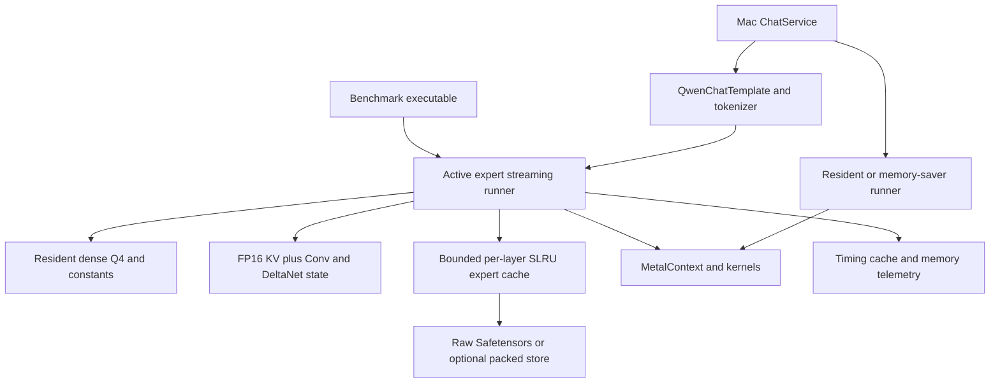
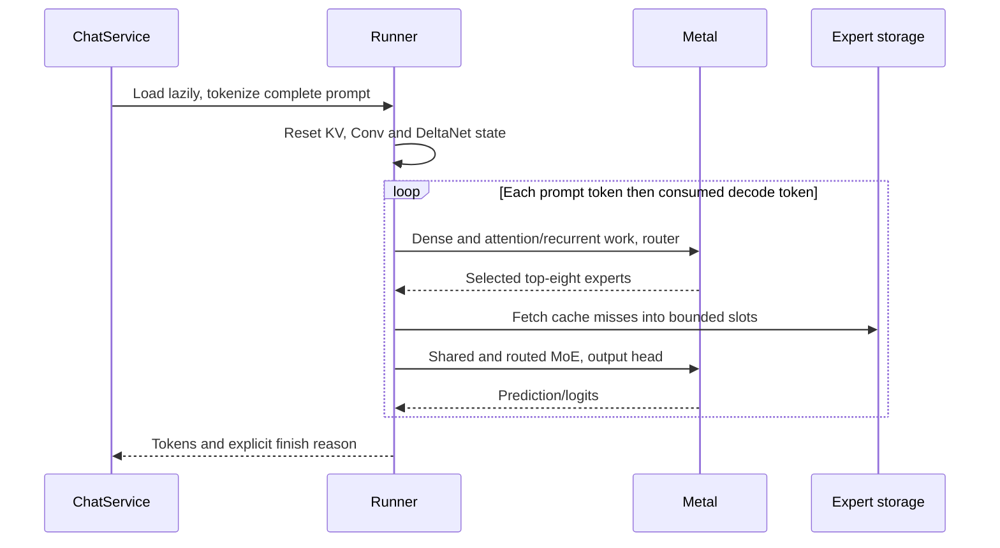

# QwenFieldfare architecture

Source audit: 2026-11-17, base commit `72fb923`. Implemented behavior below is
separate from later proposed features; S2-00 server is now implemented. [TODO](../TODO.md) owns task status;
[decisions](DECISIONS.md) own design constraints.

## Implemented modules

| Module | Responsibility and owning source |
| --- | --- |
| Core | Model IO, Swift orchestration, Metal execution, bounded expert storage and telemetry |
| Mac | SwiftUI app; `ChatService` owns runner/tokenizer references and visible/internal conversation |
| Presentation | Model-free Markdown parsing, version presentation and model-reveal policy |
| Bench | Retained-runner measurements, diagnostic profiling, checkpoint-hashed teacher forcing |
| Pack | Optional packed-expert builder; raw checkpoint remains the production default |
| Server/ServerSupport | SwiftNIO HTTP1, bounded admission and wire validation, one retained Core backend |

Core paths are relative to `Sources/QwenFieldfareCore/`:
`Runtime/Generation/QwenQ4ActiveExpertStreamingRunner.swift` is the production
active path; `QwenQ4ChatRunner.swift` provides resident and memory-saver modes
and the tokenizer wrapper. `QwenForwardRunner.swift` is CPU diagnostic/math
scaffolding with synthetic weights, not the production inference backend.
`Infrastructure/Metal/MetalContext.swift` owns device, queue, runtime shader
compilation and a locked pipeline cache. `Metal/Attention/attention.metal` and
`Metal/LinearAttention/deltanet.metal` contain attention, recurrent and MoE work.

## Model loading and validation

`QwenModelDirectory.validate` canonicalizes the root, requires metadata to be
regular files resolving directly inside it, and checks a nonempty shard map.
Index reads are descriptor-checked, nonblocking/no-follow at the resolved leaf,
capped at 16 MiB and return typed parse/read/size errors. Internal metadata links
are supported. It also rejects path components, escaping shard symlinks and
non-regular shards. It does not validate the full Qwen tensor contract.
`QwenResidentWeights` now uses the shared validated-descriptor path described
below for header metadata, selected BF16/F32 tensors and embedding rows. This CPU
utility is distinct from the Q4 Fast Resident mode. The active-streaming Q4 reader
also uses shared descriptor/header validation and owned whole-file mappings (S1-01c,
below). The fallback Q4ChatRunner resident/memory-saver reader now uses the same
validated descriptor/mapping infrastructure (S1-01d). The pack builder remains
on its independent Safetensors reader.
Preflight must be shared by every entry point, before large Metal allocations.
The checkpoint remains external; weights must never be copied into this repo.

## Shared Safetensors validation (S1-01a/b/c/d)

`Infrastructure/ModelIO/QwenSafetensorsHeader.swift` provides an internal shared
metadata parser and an owned-descriptor wrapper. **QwenResidentWeights and the
both Q4 runtime readers are migrated**. The pack builder remains on its
independent implementation. Inference kernels, numerical
precision, quantization, sampling and expert-cache allocation are unchanged.

The parser reuses `QwenTensorInfo` and the existing EINTR-aware
`QwenQ4ExpertStore.preadFully` primitive. Its metadata reads are the
8-byte prefix and header; the owner also supports checked selected-payload reads. Header length is decoded bytewise as little-endian,
must be positive, <=100,000,000 decimal bytes (the existing resident-reader cap),
and fit the opened file before allocation. Header helper offsets/counts are bounded
by 100,000,008; selected-payload calls are bounded by the validated file size <=
Int.max/off_t.max, avoiding unchecked general offset casts.
The shared parser/descriptor wrapper performs no complete-shard read, copy, mapping
or hash and creates no Metal buffer. The shared runtime mapping owner below
maps the same validated descriptor without copying shard contents.
The cap bounds header bytes, not Foundation JSON-object overhead/process footprint.

Metadata requires a UTF-8 object header (raw NUL/UTF-16/32 inputs rejected), string-valued __metadata__, complete tensor
fields, exact nonnegative integer dimensions/offsets (not bool/float/string),
checked shape multiplication and dtype-byte multiplication, ordered/in-file
ranges, exact byte extents and nonoverlapping nonempty tensor ranges. Scalars
have one element; zero dimensions yield zero elements even when other dimensions
would overflow a product. Payload bounds prove absolute offset additions fit Int.
Fixed-width BOOL/integer/FP16/BF16/FP32/FP64 metadata widths are recognized; other
encodings are typed errors. This does not add model/dtype execution support:
model-specific required names/shapes/quantization/consumed dtypes still need S1-02.

`QwenSafetensorsFile` opens a caller-resolved file URL with
O_RDONLY|O_NONBLOCK|O_NOFOLLOW|O_CLOEXEC, fstats the actual opened object and rejects
non-regular/short inputs before reading. It owns/closes its descriptor on failure
and deinit. Consumers must retain the owner, borrow (not close) its descriptor,
and use that descriptor for later reads instead of reopening a path with cached
offsets. Callers must resolve legitimate links **and enforce model-root containment
beforehand**; this wrapper does not establish root containment. An unresolved
leaf symlink is rejected; resolving an approved internal link is supported.

The opened descriptor pins device/inode identity across path replacement. Size,
mtime and ctime are compared before/after parse; `verifyUnchanged` can detect
later observed changes on that descriptor. This is not a write lock or content
hash: external writes/truncation after a check remain possible, and opening a
resolved path does not solve ancestor-directory replacement. Checkpoints must
remain immutable while owned; reader/mmap integration must define failure/retry
and lifecycle policy, never claim that validation alone prevents mmap SIGBUS.

This bounded utility is not a full canonical Safetensors framework: it permits
payload gaps/trailing bytes and does not independently detect duplicate JSON
keys or validate payload contents. Metadata parsing is no proof of checkpoint
integrity or numerical equivalence. These limits remain explicit after reader
integration. Original 131/132 release blocker is unchanged.

## Migrated CPU resident reader (S1-01b)

`QwenResidentWeights` replaces its header-only cache with one validated descriptor
owner per encountered shard. It resolves the model root, requires safe basename
shard names, resolves approved internal links and applies the existing direct-root
containment policy before opening the resolved leaf. The reader serializes cached
ownership, metadata lookup and reads with its existing lock. Header parsing occurs
once per cached owner, not again for every tensor. Public metadata keeps its old
header-size semantics (length excludes the eight-byte prefix); returned paths are
informational, not authorization to reopen an independently mutable pathname.

Tensor and row reads call `readPayload` on the same opened descriptor. Tensor
offsets remain relative to the data region; absolute position is **8 + header
length + relative offset**. Dynamic payload ranges are bounded and identity is
checked before/after reading. BF16/F32 decoding preserves float bit values using
unaligned little-endian loads. Full tensors still use the CPU API's selected raw
tensor bytes plus decoded Float array; rows use one row's raw bytes plus output.
No complete-model residency, mmap or zero-copy behavior was added/removed in this
CPU utility. Q4 modes retain mmap/zero-copy behavior; active ownership is updated below.

Unsupported decoder types are rejected before payload reads. Row dtype/shape,
hidden size, token bounds and row/output byte arithmetic are checked before
allocation/offset use; empty tensors/row requests are safe. Any failed operation
on an opened shard invalidates/releases that cached owner. There is no automatic
mutation retry; an explicit caller retry must open and revalidate anew. Owners
otherwise release descriptors at reader deinit. Existing public layer-weight
names and index-loading behavior are unchanged.

This detects observed mutation; it does not guarantee immutability or a coherent
multi-shard snapshot. Internal-link retargeting does not redirect a retained
handle. Path replacement may keep original-descriptor data or produce a controlled
identity error, never silently reopen inside the operation. External in-place
writes, ancestor/directory substitution, changes after checks, and caller misuse
of advisory paths remain limitations. Index JSON loading in QwenResidentCoreLoader
is unchanged and is not covered by the new Safetensors ownership guarantees.

The actual compatible checkpoint passed through this reader: headers **88,906,
67,237,67,875,50,269 bytes**, plus one 2,048-element norm tensor. Keep the existing
**100,000,000-byte** cap in this migration: these files are comfortably within it,
no accepted cap is expanded, and silently narrowing the supported-file policy is
not bundled with ownership work. These observations do not prove all compatible
exports fit a smaller limit. Foundation JSON overhead is not a process-memory cap.
[Evidence](evidence/2026-11-17-s101b/validation.json) records the real-reader check
separately from the active benchmark's unchanged 131/132 parity baseline.

## Active-streaming mapped reader (S1-01c)

`QwenQ4ActiveExpertStreamingRunner` now opens the shard basenames from its existing
weight map through `QwenMappedSafetensorsFile.openShards`. It reuses shared header
validation exactly once per shard, resolves supported internal links, enforces
canonical direct-root containment, and maps the **same validated descriptor**.
Index JSON ingestion is unchanged/unbounded here; shared index preflight before
large allocations remains separate work. Fallback Q4ChatRunner and pack-builder
Safetensors readers are not migrated by S1-01c.

Ownership chain: runner -> mapping owner -> validated file owner -> descriptor;
LM-head Metal buffer -> deallocator closure -> mapping owner. Default retained
Metal command buffers retain buffers through GPU use. No owner retains a Metal
buffer, so no cycle exists. ARC unmaps first and releases/closes the descriptor
only after the last runner/buffer lease ends. Closing a descriptor alone would
not invalidate mmap; this implementation explicitly owns both resources. There
is no forced close/unmap API. Partial shard-set/mapping/buffer initialization
unwinds owners; already-created Metal buffers independently retain their maps.
CPU embedding, BF16 decode, dense staging and joined expert-read dispatch borrow
pointers only while the runner retains the shard owners. Cancellation occurs
between synchronous forwards; ChatService's task retains the runner, deferring
unload until cleanup. Even outstanding GPU buffer references keep maps alive.
Concurrent calls into one runner remain unsupported (existing stateful contract).

Whole files remain read-only MAP_SHARED mappings, rounded to page length with
checked arithmetic. Final-page padding is mapped only to satisfy Metal's existing
page-aligned bytesNoCopy window; logical tensor accesses stay within actual file
bounds. Neither headers nor weights are copied from mmap into a full-shard heap
allocation. Slices use `8 + headerByteCount + dataOffset`, with checked shared
payload extents; page window calculations reject overflow, empty/out-of-range
buffers, and windows outside the rounded mapping. CPU bit loads allow unaligned
payload starts (the supported checkpoint has non-aligned header lengths) without
changing BF16/packed-Q4 bit interpretation or arithmetic.

Narrow consumer guards validate dtype and exact byte extents needed by the
existing fixed-size copies, norm buffers, embedding/LM head and 256-expert ranges.
They prevent under/oversized pointer reads and arena overwrites. They do not
replace S1-02's full shape, configuration and quantization contract. Token,
position and selected-expert bounds are checked before address arithmetic. The
existing dense arena/expert cache sizes and all shader/selection math remain
unchanged. Expert pread uses the shared EINTR-aware read helper with validated
ranges. A short/failed read records a recoverable error; after parallel reads
join, pending hit work completes, slots clear, and forward throws before any
failed miss is consumed. There is no mapped memcpy fallback after a read failure.
The failed generation must be abandoned/reset through the existing request path.

Descriptor identity pins the opened inode, not the pathname: replacement/unlink
never silently redirects metadata/mapping/reads to the new path. Size/mtime/ctime
checks run around validation/mmap and before each normal forward; observed changes
fail closed. These are **not immutability guarantees** or coherent multi-shard
snapshots. Parent-directory substitution, writes after a check and adversarial
same-metadata mutation are not solved. An immutable, trusted local checkpoint is
required for the entire CPU/GPU ownership lifetime, including diagnostic profiling.
Concurrent truncation can still SIGBUS, and in-place writes can change CPU/GPU
results. Never truncate or edit loaded weights. Model-free mutation tests truncate
fixtures only without subsequent mapped access, checking recoverable metadata or
pread failure and cleanup. They deliberately do not trigger a mapping fault in
the package process; this validates observed-mutation handling, not fault recovery.
A process-isolated destructive stress test is required before claiming stronger
concurrent-mutation behavior. No real checkpoint is modified by tests.

Focused fixtures cover exact/cross-page offsets, bounds/overflow, malformed files,
file types, internal links, replacement, mmap/post-map failure, partial init,
Metal-command ownership, failed buffer initialization and repeated ARC release.
The 100,000,000-byte header cap is retained; observed real shard headers are
88,906 / 67,237 / 67,875 / 50,269 bytes. See S1-01c evidence for integration/parity;
token-only non-regression is not numerical equivalence or release qualification.

## Fallback Q4 mapped reader (S1-01d)

`QwenQ4ChatRunner` reuses QwenMappedSafetensorsFile for whole-shard read-only
mapping from validated descriptors, shared header parsing and data-relative
ranges. It obtains shard names from the existing weight map with safe basename,
canonical root containment and supported internal symlink rules. Index JSON
loading is unchanged/unbounded here. Required consumed tensor dtype/byte extents
reuse the existing active runner's internal fixed-Qwen guard; no parallel model
layout table or new parser is introduced. Moving that existing table into full
pre-allocation model-contract validation remains S1-02 work.

Existing strategies remain: fast-resident populates40 layer entries, memory-saver
lazily loads/evicts its configured layer cache (default4). Quantized weights use
no-copy buffers for embedding, head and layer triplets; BF16 constants remain
small decoded/copied Float buffers. No full-shard heap copy, tensor conversion,
quantization, expert policy, sampling or GPU arithmetic is added. Unaligned CPU
bit loads preserve the existing BF16/Q4 interpretation for non-aligned payloads.
Context allocation products are checked before allocation; the original FP32
fallback KV byte sizes are retained, including reset lengths. Scratch constants
are fixed-size, decoded constant output byte multiplication is checked, and
constant/state allocation failures throw recoverable runner errors. Existing
encoder/command fatal paths remain S1-04, not a completed recoverability claim.

Runner -> shared mapping owner -> validated file -> descriptor; every no-copy
Metal buffer -> deallocator lease -> mapping owner. Cached-layer eviction drops
buffer references, not live mapping ownership. All fallback GPU submissions use
retained-resource command buffers and wait for completion before the next layer;
buffer leases also cover outstanding GPU references on failure/unload. There is
no manual unmap/close in fallback deinit. Failed mapping/initialization and ARC
teardown release resources; no close API can invalidate a surviving lease.
Token/position bounds and observed descriptor metadata changes are checked before
normal forward. Invalid initialization/context/tensor inputs return typed errors.
Concurrent runner calls remain unsupported. Cancellation remains between forwards.

The immutable-checkpoint requirement and race limitations above also apply here:
retained descriptors pin inode identity, never immutable bytes. Path replacement
cannot silently redirect a retained mapping; metadata checks may fail closed.
Concurrent truncation can SIGBUS; ancestor replacement and coherent multi-shard
snapshots remain unresolved. The header cap remains100,000,000 decimal bytes;
previously measured supported header lengths88906/67237/67875/50269 fit. No stricter
policy is adopted from these observations alone.

The strict teacher harness constructs only the active-streaming runner. S1-01d
does not alter that execution path and does not rerun or claim fallback parity
from its retained131/132 evidence. A separate short-context memory-saver
integration exercises actual fallback loading, evictions, reset and unload;
it is a smoke test, not MLX equivalence or fast-resident qualification. Neither
fallback budget field currently enforces a process RAM cap. Fast-resident may
retain close to the entire quantized model; it is not used for the bounded test.
See S1-01d validation evidence for the chosen test capacity and measured snapshots.

## Token execution and state ownership

The supported hybrid has 40 layers: 30 Conv/Gated DeltaNet layers and 10 causal
full-attention layers (every fourth layer). Each layer routes top eight of 256
experts and evaluates a shared expert. Full attention uses the complete occupied
prefix; no sliding-window eviction is authorized. Kernels with SWA names do not
establish Qwen sliding-window semantics.

The active runner owns dense arenas, scratch, expert cache and mapped shards.
It owns FP32 Conv/DeltaNet recurrent buffers and token-major FP16 K/V buffers
for full-attention layers. KV is allocated for selected maximum context, not
only the number of occupied tokens. `initStates` throws on failed state-buffer
allocation; other production allocations still force unwrap. No cross-request
state reuse exists: `generateResult` resets all sequence state, then calls
`forwardToken` for every prompt token. Intermediate prefill predictions still
run the LM head. Decode consumes the previous prediction to compute the next;
the final emitted token may not yet have been consumed by model state.

## Expert storage and memory

`Q4BoundedExpertCache` retains a fixed Metal arena, entropy-weighted layer
partitions, probationary/protected SLRU, and top-eight slot protection. Parallel
reads target independent slots; shared/hit compute overlaps miss IO. A slot is
1,769,472 bytes. Raw ranges are the default; `QwenQ4ExpertStore` implements the
optional manifest/hash-validated packed format. The older `Q4ExpertPackedStore`
also exists and needs a separate safety review; it is not interchangeable with
the version-2 store contract.

`QwenActiveStreamingMemoryConfiguration` checks arithmetic and plans 3/4/5 GiB
Metal targets, context-dependent FP16 KV and scratch, resident buffers, reserve
and remaining cache slots. Five GiB is default; a valid plan requires at least
320 cache slots. This is an allocation estimate, not a process-RAM cap. Mapped
pages, physical footprint, system cache, pressure and swap require measurement.
Memory-affecting settings unload the runner. Do not live-resize an expert arena.

## Lifecycle, cancellation and errors

`ChatService` is MainActor UI orchestration. Normal `send` uses a detached task
for blocking loading/inference and publishes UI updates on MainActor. It keeps
separate visible messages and committed template history; successful generation
commits a user/assistant pair, while cancellation/error can leave visible turns
outside committed history. `loadModelIfNeeded` is a second loading path and
requires consistent lifecycle gates. Cooperative cancellation is checked between
prompt tokens and decode steps; loading is not comprehensively cancellable.
Unload requests cancel active work and defer release to cleanup. Both Q4 runtime
readers use ARC-owned mappings/descriptors, with Metal buffer leases and partial-init
cleanup; broader cancellation/failure lifecycle qualification remains open. `@unchecked Sendable` does not serialize mutable runners.

Typed configuration/model/runner errors coexist with forced buffers and fatal
encoder/command creation. Error propagation and injection are Stage 1 work;
recoverability is not yet qualified. S2-02 adds a cooperative cross-process Q4
owner lease; unrelated inference products still require manual exclusion.

## Later architecture: partly superseded by S2-00

Stage 2 adds typed checkpoint-specific messages/tool calls and a bounded
incremental parser; tools execute only in clients. S2-00 now supplies the minimal server described below. Later stages extend
`QwenFieldfareServer`, loopback/authenticated HTTP, bounded admission and SSE
backpressure, disconnect cancellation, and one serialized inference owner.
Networking must run independently from blocking GPU/IO work. App, bench and
server now share the Core Q4 lease. S2-03 implements native server management.
See [integration contract](AGENT_INTEGRATION.md).

S3-00d covers one retained exact-prefix session including KV, Conv and
DeltaNet. Idle expiry, a separate retention limit and lazy KV allocation
remain future work. See the [state contract](EXACT_PREFIX_STATE_CONTRACT.md).

## Numerical qualification index

The [observed numerical contract](NUMERICAL_CONTRACT.md) distinguishes activation,
state, KV and accumulation precision. In particular, native MLX recurrent state
is FP32; its Conv history is BF16, while Swift uses FP32 for both. Contract and
matched-input local tests do not replace full-model parity qualification.

## S2-00 design before implementation

Use existing SwiftNIO2.101.3 (Apache2.0), made a direct dependency, NIOHTTP1/Posix.
One retained Core active runner/tokenizer, existing chat formatter, reset/replay
per request, selected3/4/5GiB planner. No Core math changes. Networking remains
on NIO event loops; generation runs in detached work, one active and two queued
requests, explicit overload rejection. Shutdown/disconnect cancel work; runner
remains retained until synchronous Metal work and generation finish.
Loopback-only bind, required environment bearer secret, no CORS/content logging.
1MiB body,128 messages,4096 output tokens, context reservation before inference;
one request per HTTP connection, bounded outbound watermark and cancellation for
slow clients. HTTP errors before SSE start; error event and close after start.
No tools, response formats, logprobs or arbitrary unsupported fields accepted.
Wire references reviewed: https://developers.openai.com/api/reference/resources/chat/subresources/completions/methods/create
and https://developers.openai.com/api/reference/resources/chat/subresources/completions/streaming-events
NIO source/example reviewed locally and https://github.com/apple/swift-nio .

## S2-00 implemented outcome

Implemented architecture above in ServerSupport Protocol/Service/HTTP and Server
main. Model initialization completes before listening; readiness is explicit,
startup errors exit nonzero.32 connection cap and15s request-body deadline bound
idle senders; write timeout10s covers stalled peers. Default HTTP request limits
and serialization are in AGENT_INTEGRATION. Client disconnect cancels its job;
server SIGTERM/SIGINT cancels and drains before event loops exit. Signal callbacks
are installed from a nonisolated function to avoid inheriting MainActor. At that historical milestone, server
flock excluded other servers only; S2-02 now extends ownership to both Core Q4 runners.
Real HTTP JSON/SSE/reuse/recovery/shutdown passed; see S2-00 evidence. These tests
do not qualify tool calling, full-context/long-agent quality, exhaustive socket
soak or legacy fatal Core allocation/encoder paths. Strict131/132 remains open.

## S2-01 contract design before implementation

Use the already-resolved Swift Jinja engine to render the checkpoint's exact text
template for tool/history requests; keep the existing Core formatter for ordinary
no-tool requests. Local and official templates differ only in training-generation
annotations/equivalent prefix placement, not rendered text semantics. Developer
role is unsupported by checkpoint and rejected. Thinking disabled; assistant
generation prefix and im_end stop remain unchanged. Native tool syntax is not JSON.

Typed ordered JSON/schema/function/call/history values, strict JSON duplicate/depth
validation; explicit supported schema subset. Validate ID associations and pending
call/result sequence before serialization; reject reserved structural delimiters
in untrusted tool-result text rather than permit role-boundary injection. Tool
results remain untrusted instructions even without delimiter injection.

Incremental parser releases only safe prose, holds delimiter prefixes across
fragments and buffers structured tail <=256KiB. Calls commit only after full
turn validation, known names/schema and genuine EOS; output-limit/cancel never
creates an executable call. Complete calls receive stable IDs and indexed SSE
argument fragments after commit. Conservative delayed tool deltas intentionally
trade tool latency for no partial executable/native-syntax leakage. All existing
HTTP ownership/auth/queue/cancellation bounds remain. No tools are executed here.

## S2-01 implemented outcome

ServerSupport now owns ordered strict JSON/schema/function/history types, exact
checkpoint Jinja rendering and NativeToolParser. Core numerical sources are
unchanged. Existing Swift Jinja2.3.6 is explicitly depended on, with no pin upgrade;
HF-compatible ordered Unicode JSON filter is scoped per render. No-tool Core
formatter remains the original path. Bounded file descriptor reading of the
trusted local template caps metadata at256KiB and preserves root containment.

HTTP Output owns per-request parser state. Safe prose streams incrementally;
structured tail is buffered until complete EOS validation, then translated to
stable IDs and indexed argument fragments. Backend emits raw decoded tokens only
internally. Usage counts all native model-output tokens, not just JSON argument
characters. Client tools are never invoked. Result IDs/order/schema are validated
before the native no-ID representation groups tool responses into a user frame.
Context reservation runs after schemas/history serialization and tokenization.

Real JSON and SSE cycles produce get_project_status(project=fieldfare), accept
client mock status=building-local-agent and produce final model text using it.
Unit tests and Python/official-template goldens separate parsing/transport from
model choice. See integration guide for strict schema/delimiter restrictions,
trust boundaries and delayed tool-SSE tradeoff. Stage1 remainder stays deferred;
no prefix state reuse or filesystem agent has been introduced.

## S2-02 design before implementation

Retain existing executable/server/Core. Add a small parsed configuration value,
help/version,explicit loopback host,permission-restricted key file or env secret,
validated context/memory/port/queue and actionable non-sensitive startup errors.
Admission queue capacity becomes configurable0–8,default2; existing behavior is
preserved. A Core RAII process lease acquired before either Q4 runner allocates
Metal prevents app/Bench/server from silently competing. No math/cache policy
changes. This guard does not add UI controls or a second generation service.

Installed OpenCode1.19.5 uses v1 provider/npm/options/agent configuration despite
current website v2 syntax. Qualify exact installed schema via isolated XDG paths,
explicit --dir/PWD (the CLI otherwise used inherited repo directory), --pure,
no user plugins/Claude instructions, restricted tools and a disposable Git repo.
Capture-only transport inspection is not model qualification. Observed tool
schemas need $schema2020-12 and numeric bounds, which must be validated rather
than dropped. Keep full native-output validation/delayed tool deltas unchanged.

## S2-02 implemented outcome

ServerConfiguration validates startup independently of model construction. CLI
help/version need no secret/checkpoint; host is explicit loopback,port0–65535,
context checked by existing memory planner,budget3/4/5,queue0–8. API key is env OR
an owned/private/regular bounded descriptor read with no leaf symlink following;
key descriptions/errors redact contents. No framework/dependency was added.
Admission preserves one active worker and bounded FIFO waiting; health reports
observed occupancy. Existing disconnect/drain behavior is retained.

Both Q4 runner constructors retain a Core QwenInferenceLease acquired before
Metal/model allocations. A per-user0600 persistent flock file,O_NOFOLLOW/O_CLOEXEC,
regular/ownership/mode checks and ARC close provide cooperative exclusivity across
app/Bench/server,including failed initialization. Never unlink a live lock file.
This is not a malicious-same-UID security boundary or an exclusion mechanism for
MLX/Ollama/LM Studio. Existing UI chat uses the guarded constructors; at that milestone no UI controls or connection-to-CLI existed; S2-03 below now
implements in-process exclusive server mode and read-only CLI observation.

Installed OpenCode1.19.5 emits explicit2020-12 schema metadata and numeric bounds.
The supported subset now validates/enforces those constraints (precise Int64
comparison with existing Double semantics outside Decimal's exponent range),
without broad schema support or skipped constraints. The sanitized actual tool-
continuation fixture exercises the installed SDK wire shape. Tool formatting,
normal EOS validation,buffer limits and delayed SSE call commitment are unchanged.

Actual disposable client workflow completes read/search/read,failing unittest,
implementation and incorrect-expectation edits,retest and final answer. The model
ran tests before edits, contrary to the requested implementation-first sequence;
the evidence records this deviation. One earlier absolute-permission-pattern
failure is preserved. No server filesystem/shell execution occurs. First content
167.929s,first tool173.368s,8 requests/1696.73s total,prompt3410–5233 tokens. All
sequence state still resets/replays each request; no prefix-reuse claim. Context/
output errors and admitted client cancellation/recovery are verified. See
[S2-02 evidence](evidence/2026-11-17-s202/README.md) for memory and limitations.

## S2-03 design before implementation

Use an in-process observable management controller over the existing CoreBackend
and LocalServer, not a child executable. This reuses model/HTTP/tool/queue code,
has no binary-location/package/supervision problem and cannot orphan a child on
app exit. Native chat is explicitly suspended, cancelled, drained and unloaded
before server construction; remains disabled until owned server shutdown/model
release. Both Q4 lease guards remain the cross-process backstop. App termination
waits for graceful drain. A crash shares the app/server fate; no independent child
survives. Server settings persist, server never auto-starts on launch.

Independently launched CLI instances can be authenticated and observed over
loopback using the same credential; never stopped/reconfigured by the UI. Port
or model-owner conflicts produce recoverable errors. Keychain stores the app's
credential; private temporary0600 file uses the exact CLI parser/auth contract.
Explicit reveal/copy/export requires user action; no secrets in defaults/logs or
provider guidance. Loopback health observation rejects redirects and caps bytes.

Add bounded aggregate health counters and one last-request timing record. Measure
admission/queue,format/tokenize,prefill/first generated token,visible SSE,parser
buffering,decode-after-first and overall duration where observable. No prompts,
source,tool data or tokens are retained in diagnostics. No Core math or cache
reuse changes. Native chat does not consume server tool calls in this milestone;
external OpenCode alone executes tools. UI unavailable metrics remain unavailable.

## S2-03 implemented outcome

New QwenFieldfareServerManagement target holds observable ServerController,
ServerSettings,Keychain credential store,bounded loopback observer and
InProcessServerSession. Its injected async session factory enables model-free
state/lifecycle tests;the production factory constructs exactly the existing
CoreBackend and LocalServer. No dependency pins changed. The native executable
adds a dedicated settings sheet;AppDelegate delays Quit until owned drain.

ChatService adds a server-mode guard and async cancellation/unload barrier that
waits for detached generation and its separate loading path before model release.
Native send/load are blocked in server mode. Server shutdown drops the backend
before unblocking native chat. External mode only uses authenticated bounded GET
health;Stop becomes Disconnect and Quit leaves that CLI alive. Settings persist,
keys do not enter defaults,and reopening never starts inference. The existing
cross-process Core Q4 lease remains the final ownership guard. A restart regression
found TCP cleanup rejection;SO_REUSEADDR now permits immediate rebinding without
SO_REUSEPORT. Actual bind/ownership checks remain authoritative against races.

Server health adds typed diagnostics,capped counters and one last finished
request. Per-request recorder timestamps format/tokenize,prefill callback,
first generated token/visible SSE flush,tool delimiter buffering through commit,
queue/admission and finishing durations. Native parser's only added API exposes
its existing buffering state;no parser acceptance or mathematical path changed.
Counters classify parser failure separately from cancellation,including queued
cancellation that skips inference. No payload/token history is retained.

150 package passes +3 skips,release36.68s. Controlled real native UI checks pass
for generation before/after,exclusive transition,JSON/SSE/tools/OpenCode,start/
active-prefill stop/restart,owned Quit/reopen and independent CLI observation/quit
non-interference. The UI automation required a disposable .app wrapper around the
exact SwiftPM release binary/resources;no distribution/signing claim follows.
All Core and Bench source,dependency pins,teacher harness/reference remain
byte-identical to f2f5672. Strict131/132 remains unresolved;no new parity replay.
S2-03 is diagnostic/lifecycle work,not prefix reuse,kernel optimization or a
measurement of improvement over the preserved long OpenCode workflow.

## S3-00 exact-prefix investigation — rejected candidate

The original attempt failed sustained same-Swift raw-token equivalence.
At that checkpoint the candidate was fully reverted and S2-03 replay
behavior and lifecycle were restored.

The candidate proved useful natural tool prefixes with one consumed-token ledger
and existing KV/Conv/DeltaNet buffers. Its proposed EOS/pending-token,strict-prefix,
transactional flush/epoch and cancellation contract is recorded in
[state contract](EXACT_PREFIX_STATE_CONTRACT.md), now updated for S3-00d.
Five short tool-cycle pairs matched,then a512-token continuation diverged at
output index465. A full-replay-only cold/warm expert-history diagnostic reproduced
the two outputs. Existing hit/miss MoE subset reduction ordering is the hypothesis;
no first-operation attribution or numerical fix was attempted. Exact token history
alone cannot guarantee equivalence to a replay whose expert residency differs.

[Evidence and rejected patch](evidence/2026-11-18-s300/README.md) retain the failure,
measurements and reproduction. Any future cache implementation needs a separately
scoped numerical/history-invariance contract and relevant reference gates;no
recurrent rewind or weakened expected tokens is accepted. MLX131/132 is independent
and remains a release blocker. S3-00d requalifies reuse separately.

## S3-00a expert-cache residency

The legacy active streaming MoE scheduler submits hit-only work while the CPU
loads missing expert records into distinct slots. Both paths compute gate/up
and weighted down projections using the same SIMD functions. The down projections
reduce each subset separately, so hit/miss placement can influence FP32 output
even when the contributing values are identical. S3-00a reproduced the effect
with controlled masks and isolated it using an alternate router-order combine.
See [measured results](evidence/2026-11-18-s300a/README.md).

The experimental combine uses one 65,536-byte runner scratch buffer. Hit and
miss kernels write disjoint router rows. The same serialized Metal queue orders
both producers, the final combine, and the next layer's reuse of the buffer.
This preserves CPU/GPU overlap and the expert-weight cache policy. S3-00a
archived the experiment and left production on the legacy reduction. S3-00c
superseded that choice while retaining full prompt replay.

## S3-00c production router-order expert sum

The active streaming runner preserves hit-side GPU and CPU refill overlap.
Both subsets now write their weighted down projections to disjoint
router-position rows of one shared scratch buffer. The existing serialized
Metal queue orders both producers, the final combine, and reuse of scratch
by the next layer. The final kernel folds the eight positions in fixed order
and combines the attention residual and shared expert as in the selected
original router-order prototype. Cache occupancy no longer partitions the
sum. Controller/fallback paths, cache policy and sequence reset are unchanged.

This replaces two 8 KiB subset accumulators with one 64 KiB allocation.
The plan charges 48 KiB to its existing safety reserve without changing
slot counts or 3/4/5 GiB target limits. Scratch is per runner, reused across
layers. No other buffers are retained for conversation reuse.

The alternate `residual + (routed + shared)` grouping survived compiler
reassociation tests but did not improve the important boundary margins.
The selected path is the new full-replay control for S3-00. Its documented
local MLX fidelity limits and the original strict 131/132 gate still apply.
See the [S3-00c decision and requalification handoff](evidence/2026-11-18-s300c/README.md).

## S3-00d exact-prefix server state

The standalone and native server share one opt-in `CoreBackend` mode.
The active streaming runner holds one context-bounded consumed-token
ledger and reuses its existing attention KV, Conv and DeltaNet allocations.
Native chat and the default server setting always replay. The model lease,
serial admission and expert-cache residency policy are unchanged.

The complete retained ledger must match a proper prefix of the newly
formatted and tokenized prompt. A fresh last prompt token always generates
the new request's first prediction. A mismatch clears sequence buffers
and replays from position zero. Changing schema, template branch or
sampling identity invalidates prior state. A context or output limit
leaves the last output unconsumed and disqualifies publication.

Valid metadata is published after EOS, decoder and native tool validation
and the final successful HTTP flush. The cancellation token arbitrates
terminal delivery versus disconnect. Clear and shutdown invalidate
through a locked epoch without touching GPU state owned by current work.
Metal completion errors are checked at existing queue barriers. A
recoverable failure prevents publication and requires fresh replay.

The only variable allocation introduced by reuse is one CPU token array
bounded by context, plus its normal allocation capacity. Health reports
that capacity and aggregate timing and cache counters. See the
[exact state contract](EXACT_PREFIX_STATE_CONTRACT.md) and
[runtime controls](RUNTIME_CONTROLS.md).
