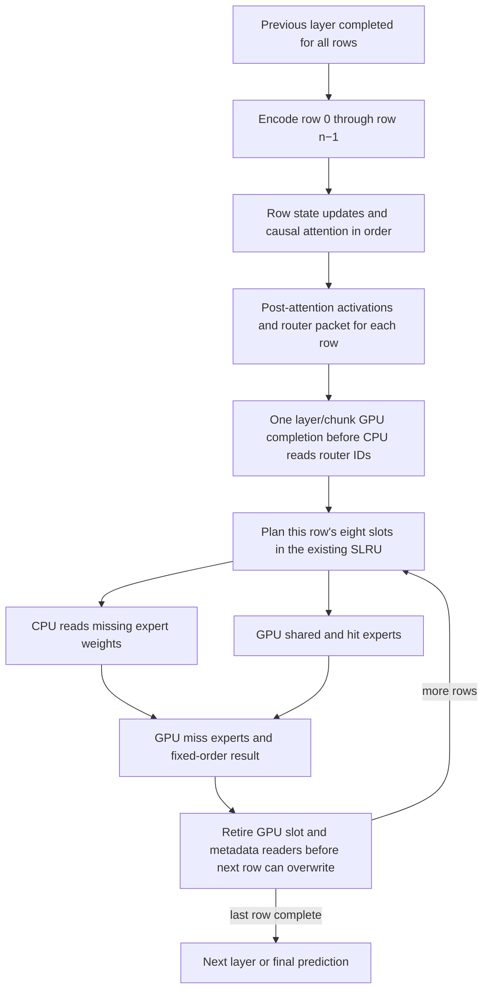

# S3-01b bounded router-readback feasibility

Experiment branch `feature/bounded-chunked-prefill`, starting at
`335e4d9`. Stable inference starts at `2e5b993`. The
[S3-01a experiment](../2026-11-18-s301a/README.md) already rejected
projection-only batching. **Decision D — feasibility stop.** Layer/chunk
readback is possible. The measured router handoff lacks enough plausible
critical-path savings with the current expert service to justify a prototype.
The stable runtime stays tokenwise. S3-01a's 214-token profile spent 4,710.201 ms in
GPU commands and 5,020.546 ms in CPU waits, out of 8.740 s prefill.
These intervals overlap, so the wait total cannot estimate available savings.

## Execution dependencies

| Stage | Critical path today | Scope of grouping |
| --- | --- | --- |
| Input RMSNorm and projections | Needs that row's current-layer input and resident dense weights | Independent across rows after previous-layer outputs exist. S3-01a tested the two-dimensional dispatch. |
| Conv and Gated DeltaNet | Reads and updates this layer's recurrent history for each row | Encode a sequence in one submission. Execute all state transitions in ascending absolute position. |
| Full attention | Computes Q/K/V, applies position-specific RoPE, writes FP16 KV and reads causal keys and values through the current row | Encode in ascending position with the same split-attention sequence and a safe lifetime for mutable scratch. |
| Router scores and top eight | Uses post-attention normalized activations from that row and writes actual IDs and normalized weights | Write row-specific packets. Earlier layers must produce their hidden outputs first. |
| GPU-to-CPU handoff | A router-buffer wait exposes IDs to the CPU and retires prior commands on the same queue | A single completed attention/router command can expose the chunk's packets. This removes the implicit per-row retirement fence. |
| Slot planning and miss reads | The CPU plans eight selected slots in their layer partition and performs the required reads after submitting shared/hit work | Keep per-layer request order. Planning may evict immediately, so CPU writes require retirement of relevant prior GPU readers. |
| Shared and hit GPU work | Consumes immutable planned slots, the row's activations and routing weights | Shares a row with independent CPU miss reads. This overlap is already present. |
| Miss GPU work | Begins after required bytes have reached cache slots | Must observe the read completion and preserve contribution routing positions. |
| Fixed reduction | Combines all eight weighted routed contributions and the shared result with the row residual | Keep each row's fixed order. Reuse contribution scratch after its readers retire. |
| Inter-layer and final head | MoE outputs feed the next layer. The last layer also runs RMSNorm and LM head per token | Every row's layer output must exist before advancing the chunk. Keep the original final-prompt prediction and sampling behavior. |

Reviewed the runner and cache using a scoped graphify AST map and direct
source inspection. See the [runner](../../../Sources/QwenFieldfareCore/Runtime/Generation/QwenQ4ActiveExpertStreamingRunner.swift),
[SLRU implementation](../../../Sources/QwenFieldfareCore/Storage/Q4BoundedExpertCache.swift),
[Metal kernels](../../../Sources/QwenFieldfareCore/Metal/LinearAttention/deltanet.metal)
and [archived source](../2026-11-18-s301a/README.md). The
[bounded prefill contract](../../BOUNDED_PREFILL_CONTRACT.md) records the
earlier layer-major design and unchanged numerical policy.



## Buffer lifetime and theoretical synchronization count

The bounded schedule is structurally possible. An eight-row arena can hold
this layer's attention residuals and normalized MoE inputs (131,072 bytes),
router IDs, weights and shared coefficient (eight 80-byte aligned records),
and stable per-row RoPE vectors (4,096 bytes). That is 135,808 logical bytes
or 147,456 bytes rounded to a 16 KiB page boundary in one arena. If reused with
S3-01a's 655,360-byte page-rounded projection/hidden allocation, the combined
charge is 802,816 bytes. These are design estimates. There is no new device
allocation, measured footprint or cache-slot reduction for a batching candidate.

Keep existing per-layer Conv, DeltaNet and KV state. A single command may
include multiple sequenced encoders with shared attention scratch reused
only after its previous readers. Bind RoPE input to row-owned data or inline
copied constants. Keep the packet and activations immutable through the last
GPU reader of the expert tail. Keep active slot lists, hit/miss lists and
contribution scratch stable through their GPU reads. Keep one row's eight
planned slots protected until the tail retires. The tail follows the hit
command on the same queue and covers its reads. Eight rows can select up
to 64 distinct experts in a layer. At 2,183 total slots the source planner
gives 37–95 slots per partition, with 33 of 40 below 64. The design
does not pin that union or change SLRU victim order.

In the current path there are 40 router waits per fresh token plus one final
tail wait per token. The proposed readback count is `40 * ceil(N/8)` for
`N` fresh tokens. Each full chunk could replace 280 of 320 router waits.
At 1,010 fresh IDs the proposed count is 5,080 instead of 40,400, a
reduction of 35,320 router waits. With the current single-row expert
service, up to seven explicit slot-retirement waits per layer and chunk
can replace the seven router waits just removed. The final layer already
waits for per-token logits. This is why a count reduction alone provides
weak evidence for lower total synchronization on the critical path. In the
conservative row-by-row schedule, the 39 non-final layers could add 34,437
explicit waits for the 1,010-token case. The original per-token tail waits
remain at the final layer. That leaves at most 883 fewer wait calls in
this model, before any additional batching-specific fences. Actual waits
eliminated in S3-01b are zero.

Cancellation or a failure must drain every submitted command with relevant
scratch or slots still live. A partially advanced layer invalidates the
entire chunk's unpublished sequence state. Only a completed chunk may
append its IDs to the exact-prefix ledger, and request publication still
requires the original epoch and terminal delivery.


## Diagnostic method and decision threshold

Use an opt-in timing observer on the tokenwise schedule. Measure the 214
and 1,010-token S3-01a synthetic prompts with independent cold expert-cache
resets in one retained runner. Follow with the archived 89-fresh-ID suffix
setup under 18 reused IDs, keeping one model owner and sampling first-token
latency. Run one untraced and one traced control per case. These are
observational diagnostics. Their timing difference is not a batching result.

The probe reads completed Metal timestamps after the original token-tail
barrier. It adds no waits, commands, cache requests or shader changes.
For each row it classifies the in-queue GPU time and idle intervals from
prior tail to router, from router to shared/hit, and from shared/hit to tail.
It checks that the host and GPU clocks agree in ordering and that the
disjoint intervals sum to the measured GPU span. The CPU router wait includes
actual queueing and GPU execution. Separately record delay between GPU
completion and host return, and command encoding across router, hit and tail.

For a row with misses, use the host interval after shared/hit submission
until the ordered miss reads join. The exposed read gap is its portion after
that GPU command ends and before the tail starts. An optimistic estimate for
preserved row-local expert service allows perfect overlap of the entire
shared/hit command with the measured miss service. The remaining per-row
service is `max(0, miss service − GPU shared/hit time)`. Sum this floor with
observed GPU command time, then credit every other millisecond of prefill
to the hypothetical improvement. This is a model based on measured costs,
not a physical lower bound if a separate design changes GPU kernel time,
I/O service, or cross-row overlap. Also report the estimate if all idle
before router plus router-to-hit could disappear. That deliberately credits
planning and submissions that batching still needs.

Use the 1K fresh workload to decide whether the existing ordered service
has a credible path to the predeclared 20% target. A count reduction without
a timing mechanism does not justify the prototype. Compare host swap before
and after this bounded run. Expand to 4K or 6K only after evidence of benefit.


## Measurements and bound

All timings below are seconds. Prefill ends at the first prediction. The
traced and untraced runs used the same tokenwise path and exact prompt IDs.
Their order alternated between fresh workloads. The host file cache was
uncontrolled. The traced/untraced differences carry no optimization claim.

| Fresh IDs | Router readbacks | Untraced prefill | Traced prefill | Host router wait | GPU command time | CPU encode | GPU finish to host return |
| ---: | ---: | ---: | ---: | ---: | ---: | ---: | ---: |
| 214 | 8,560 | 8.483 | 7.000 | 4.250 | 4.548 | 0.159 | 0.400 |
| 1,010 | 40,400 | 35.016 | 34.314 | 20.856 | 22.553 | 0.764 | 1.909 |
| 89 | 3,560 | 3.229 | 2.680 | 1.776 | 1.831 | 0.063 | 0.180 |

| Fresh IDs | Prior tail to router | Router to shared/hit | Shared/hit to tail | Host miss service | Miss service remaining with full row-local GPU overlap | Optimistic prefill reduction |
| ---: | ---: | ---: | ---: | ---: | ---: | ---: |
| 214 | 0.052 | 1.544 | 0.855 | 1.910 | 1.038 | 20.20% |
| 1,010 | 0.251 | 7.346 | 4.164 | 9.403 | 5.063 | 19.52% |
| 89 | 0.022 | 0.637 | 0.190 | 0.560 | 0.244 | 22.59% |

| Fresh IDs | Expert hits | Expert misses | Logical fetched bytes |
| ---: | ---: | ---: | ---: |
| 214 | 47,221 | 21,259 | 37,617,205,248 |
| 1,010 | 216,664 | 106,536 | 188,512,468,992 |
| 89 | 21,838 | 6,642 | 11,752,833,024 |


At 1K, saving 20% requires removing 6.863 s of the traced 34.314 s.
The entire post-router wake plus the entire prior-tail-to-router gap is
2.161 s, or 6.30%, even before charging any replacement retirement wake.
The full router-to-hit gap contains planning, GPU submission and some
miss service already underway. Counting it all would be unrealistic.
Even giving the candidate all prefill time beyond measured GPU commands
and ideally overlapped row-local miss service leaves just 19.52% at 1K.
That model already gives away all encoding, all remaining dispatch gaps
and all host retirement cost. The shorter 214-token and 89-token cases put the optimistic estimate just
above the threshold. Neither establishes a measured router batching benefit. A design with faster GPU compute or
proven safe cross-row miss overlap would have different limits.

At the 1K traced point, GPU busy time splits into router/attention,
shared/hit and miss/tail with full details in [raw aggregate timings](timings.json).
The portion of host reads after shared/hit GPU completion was 2.639 s.
Miss reads may also begin before the shared/hit command starts, so that
post-hit measure alone does not capture all non-overlapped I/O. Taken
together, these intervals explain why summing 20.856 s of CPU router
waits substantially exaggerates the opportunity.

The suffix starts from a committed 18-ID prefix in both runs. Both
computed 89 fresh IDs and produced the same first token with identical
hidden and full-logit hashes. The 214 and 1,010-token pairs likewise
matched first output, hidden state, logits and cache traffic. No batched
scheduler was built or tested. The model-backed results validate the
observer's invariance on these workloads. They leave sustained batching
numerics and cancellation qualification for any future implementation.

Metal allocation remained 5,291,360,256 bytes with 2,183 slots. The maximum
sampled process physical footprint was 5,225,046,968 bytes. Sampled memory
pressure was level 1 before and after. Host swap fell from 4,859.81 MiB to
4,787.75 MiB, so there was no net growth across the probe. See
[preflight](preflight.txt) and [postflight](postflight.txt).

## Reproduction and final validation

Use the [archived timestamp probe](timing-probe.patch.gz) in a disposable
checkout of this branch. The [source and executable hashes](probe-identity.txt)
identify the measured code. The package tests run without a model when
the probe environment variable is absent.

```sh
gzip -dc docs/evidence/2026-11-18-s301b/timing-probe.patch.gz | git apply
Scripts/test.sh --filter 'QwenRouterReadbackProbeTests|QwenExpertReductionTests|QwenPrefixStateTests|QwenActiveStreamingMemoryConfigurationTests'
swift build -c release
QWENFIELDFARE_ROUTER_PROBE_MODEL=/absolute/model \
QWENFIELDFARE_ROUTER_PROBE_OUTPUT=/private/tmp/qwen-router-timings.json \
  Scripts/test.sh -c release --filter measureRouterReadbackCriticalPath
```

The [focused checks](focused-tests.txt) and [checkpoint probe](checkpoint-tests.txt)
passed. The observer and manifest additions were removed. Product sources,
scripts, tests, package manifest and pins match `2e5b993`. Strict MLX
131/132 retains the known token-61 mismatch from the archived checkpoint-
verified log. The checker verifies that evidence, and no new strict model
run was needed for the timing-only work. See [restored validation](restored-validation.txt).

The smallest next hypothesis is an offline replay of same-layer SLRU slot
read/write conflicts for two adjacent rows. Use it to bound whether extra
miss service can overlap with existing GPU work while keeping victim order.
A more invasive scheduler would require evidence from that narrower check.
